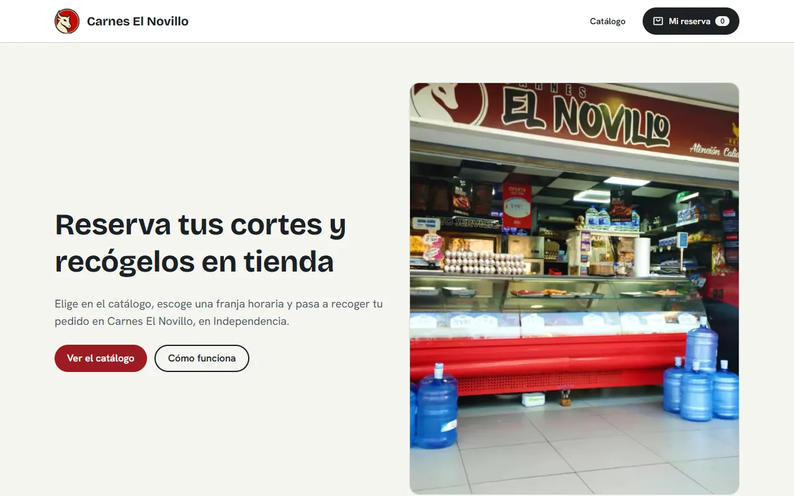
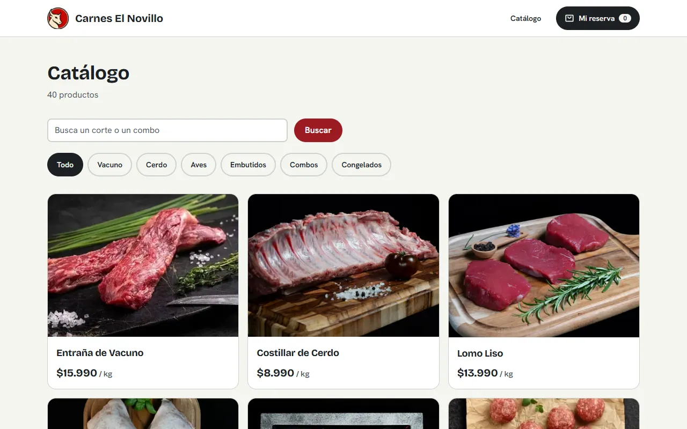
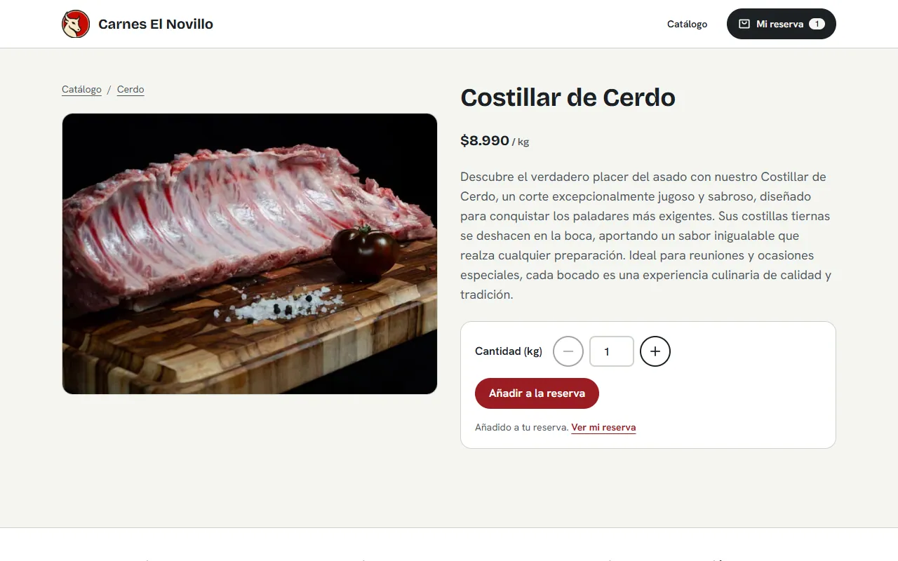
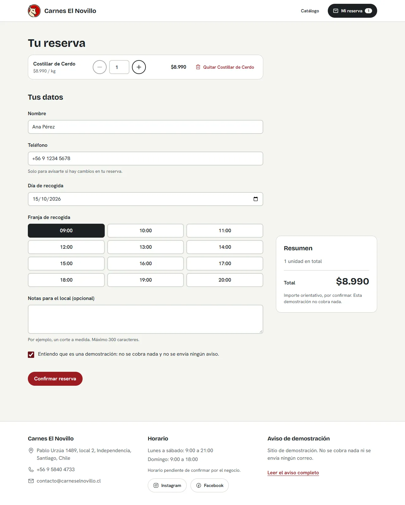
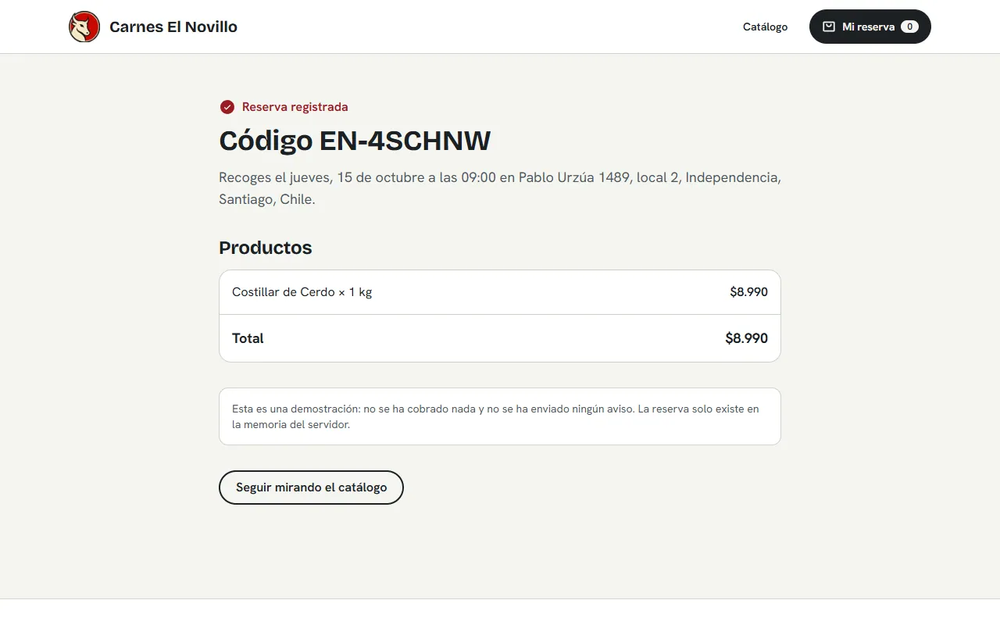
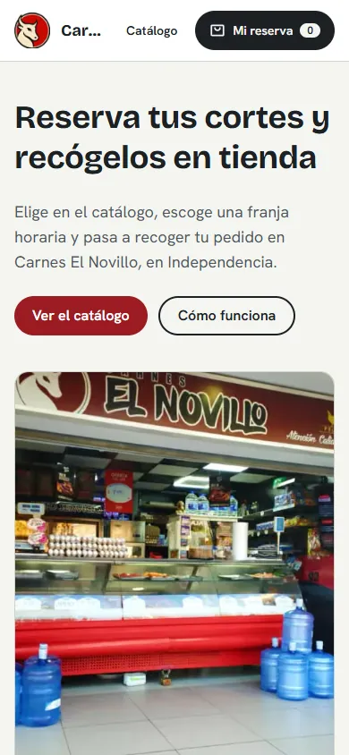
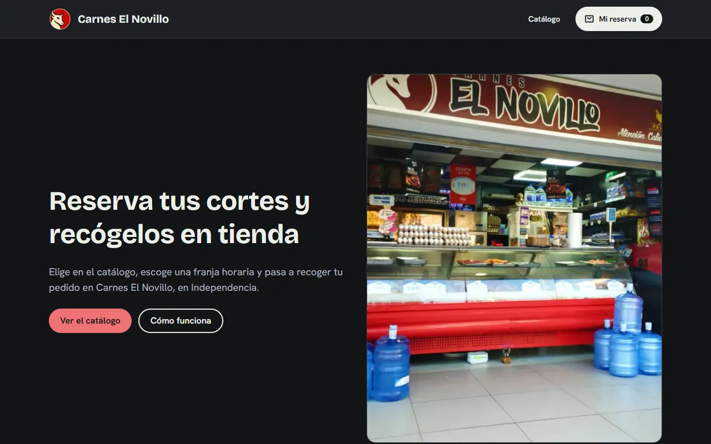

# Carnes El Novillo

> Spanish version: [README.es.md](README.es.md)

A catalogue and pickup reservation for a neighbourhood butcher's shop in Santiago, Chile: browse the cuts, add them to a reservation, pick a pickup slot and get a confirmation code. It is a **demonstration project, not a real business**. Nothing is charged, paid or emailed, and the reservations exist only in server memory.

| Home (light) | Catalogue | Product |
|---|---|---|
|  |  |  |

| Reservation | Confirmation | Home (dark, mobile) |
|---|---|---|
|  |  |  |

The dark theme follows the system preference: 

## What it demonstrates

- **The server never trusts the client's prices.** The reservation sends identifiers and quantities only. `POST /api/reservas` re-prices every line from the catalogue and rejects the whole request if one line is unknown. A `totalClp` or `priceClp` sent by the client is ignored, and an end-to-end test proves it.
- **Pickup slots with real rules.** Hourly slots that follow the weekly opening hours, at least 2 hours of lead time, a 7-day horizon and 4 reservations per slot. Every rule is evaluated with the shop's clock in `America/Santiago`, not the server's. The rules are unit tested.
- **State without effects.** The reservation lives in `localStorage`, is validated with zod when read, and is exposed through `useSyncExternalStore`. A corrupted value falls back to an empty reservation instead of breaking the page.
- **Logic separated from UI.** Pure functions in `src/lib`, state in `src/hooks`, presentation in `src/components`. No component calls `fetch`; there is one API client.
- **Accessibility as a test, not a claim.** axe runs over every page in light and dark themes, on desktop and mobile, with WCAG 2.1 AA and best-practice rules. The suite fails on any violation.
- **Content as typed data.** 40 products live in `src/content`. A test checks that every photo exists, slugs are unique, prices are positive integers and every product belongs to a defined category. Another test fails if an em dash or en dash appears in the content.
- **Honest copy.** Opening hours and the contact email are marked as pending confirmation in the notice (`/aviso`). Prices are in Chilean pesos (CLP). The old site's reviews, certifications and delivery claims were removed (see below).

## Quality

| What | How | Count |
|---|---|---|
| Unit tests (logic and content integrity) | Vitest | 53 tests in 13 files |
| End-to-end, API contract and accessibility | Playwright + axe | 53 runs: 17 flow and API tests on desktop, 36 accessibility runs in 4 projects (light and dark, desktop and mobile) |
| Types | `tsc --noEmit`, `strict` + `noUncheckedIndexedAccess` | clean |
| Lint | ESLint 9, `next/core-web-vitals` | clean |

CI (`.github/workflows/ci.yml`) runs lint, typecheck, unit tests, build and the Playwright suite on every push and pull request.

### Measured performance

Lighthouse 12.8.2, mobile emulation with simulated throttling, production build served locally with `next start` (no CDN), median of 3 runs per page, measured on 2026-10-12. The reservation page was measured with an empty reservation.

| Page | Performance | Accessibility | Best practices | SEO | LCP | CLS | TBT |
|---|---|---|---|---|---|---|---|
| Home | 96 | 100 | 100 | 100 | 2.7 s | 0 | 85 ms |
| Catalogue | 90 | 100 | 100 | 100 | 3.6 s | 0 | 53 ms |
| Product | 95 | 100 | 100 | 100 | 2.9 s | 0 | 50 ms |
| Reservation (empty) | 91 | 100 | 100 | 100 | 3.5 s | 0.002 | 91 ms |

These are lab numbers on localhost. A deployed site behind a CDN will differ, and real-user data would say more than any of this. The catalogue was re-measured after giving the first three product photos eager loading; the other pages were measured on the build before that change, which does not touch them.

## Architecture

```
src/
  app/          Routes only: pages, API route handlers, metadata, favicon
  components/   Presentation: props in, callbacks out (ui, layout, home, catalog, product, reservation)
  hooks/        State: use-cart, use-reservation-form, use-slots, use-add-to-cart
  lib/          Pure logic: pricing, cart, slots, dates, schemas, reservations, stores. No React
  content/      Typed data: products, categories, hours, copy, notice
e2e/            Playwright specs: shop and reservation flow, API contract, accessibility
scripts/        Image optimisation (images-src -> public/images, WebP)
```

## Decisions and trade-offs

| Decision | Choice | Trade-off |
|---|---|---|
| Money | Integer pesos (CLP), no decimals | Formatting happens only at the edge (`formatClp`) |
| Catalogue filters | Category and search live in the URL and are applied on the server | Works without JavaScript and can be shared; the page is rendered per request |
| Reservation persistence | `localStorage` + zod, no backend session | The reservation does not follow the user across devices |
| Reservation storage | In-memory repository behind a `ReservationRepository` interface | Reservations vanish on restart; a database is one more implementation |
| Rate limiting | Sliding window in memory, 40 requests per 10 minutes per IP | Per instance; a shared store is needed with several instances |
| Motion | CSS transitions only, disabled under `prefers-reduced-motion`; no animation library | Little choreography, and no extra bundle |
| Theme | Light or dark from the system preference, one theme per page | No manual toggle yet |
| Photos | One WebP per product, 800 px maximum, generated from originals kept out of git | Products without a photo show a neutral placeholder |

## Removed from the previous site

The earlier site published several claims this rebuild does not repeat, because nothing in the repository proves them:

- **Customer reviews.** The old reviews came with generic stock avatars and names, so they were treated as invented and removed. The home page now shows three example reviews with invented names and no photos, under the label "Reseñas de ejemplo, no son reales"; the notice says so too.
- **Founding year, certified suppliers and sustainability claims.** Not verified, removed.
- **Delivery and payment methods.** This demonstration does not deliver or charge, so the claims were removed.
- **Nutritional values per product.** They were not sourced, so they were removed.
- **Two empty categories** (lamb and grill sets) that had no products.

## Known limitations

- **Reservations are not durable.** They live in server memory and are lost on restart.
- **The slot capacity check is not atomic.** Two simultaneous requests can both pass it. A real database needs a transaction in `ReservationRepository.save`, as documented in the interface.
- **No payments, emails or staff view.** There is no shop-side screen for incoming reservations.
- **Opening hours and contact email are pending confirmation.** The published hours come from the previous site and are shown with that caveat on `/aviso`.
- **The capacity and lead-time policy is a demonstration value** (4 per slot, 2 hours, 7 days) and is marked as pending on `/aviso`.
- **No public holidays.** Hours are weekly only.
- **Spanish only.**

## Run it

```bash
pnpm install
pnpm images                  # only if you have the originals in images-src/ (not versioned)
pnpm dev                     # http://localhost:3202
```

| Script | What it does |
|---|---|
| `pnpm lint` / `pnpm typecheck` | ESLint / TypeScript |
| `pnpm test` | Vitest unit tests |
| `pnpm build && pnpm test:e2e` | Production build, then Playwright (starts `next start` on port 3202 itself) |
| `pnpm images` | Converts originals in `images-src/` (not versioned) to WebP in `public/images/` |

Set `PW_CHROMIUM_PATH` to use an already installed Chromium for the E2E suite; otherwise run `pnpm exec playwright install chromium` once.

## About this repository

This is a from-scratch rebuild of an earlier prototype. None of the earlier code, styles or configuration was kept. The product texts, prices, photographs, business name and contact details were carried over from the previous site and reviewed; the claims listed above were dropped. The history here is the real build history.

## License

The code is MIT licensed (see [LICENSE](LICENSE)). The photographs in `public/images` and the product texts in `src/content/products.ts` are **not** covered by that license. They belong to their owners and are included for demonstration only.
